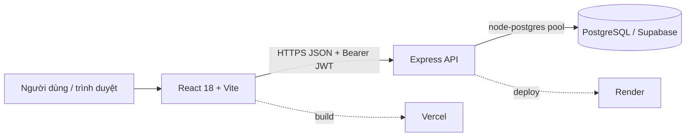
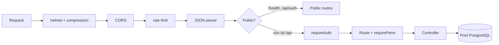
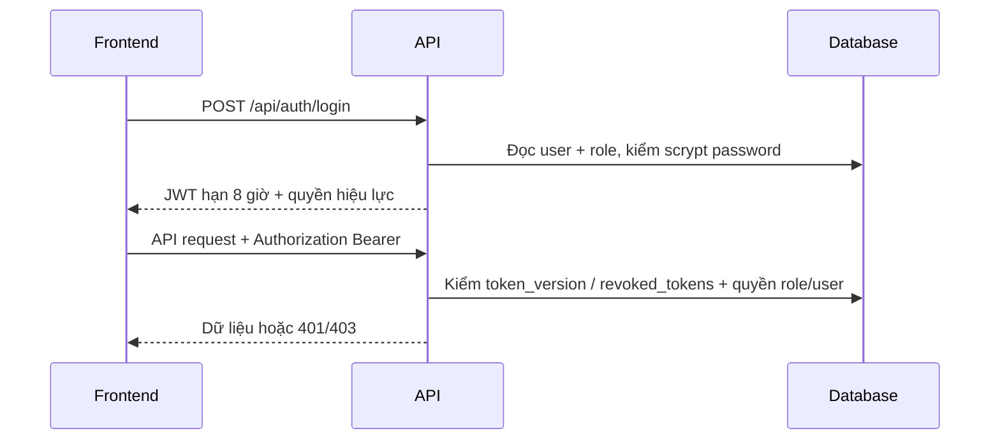
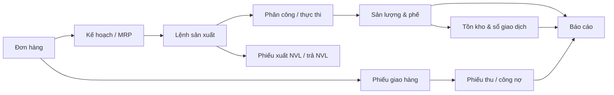

# Kiến trúc hệ thống MES

> Cập nhật theo mã nguồn hiện có ngày 12-11-2026. Tài liệu mô tả kiến trúc phần mềm; không phải ảnh chụp trực tiếp của database production.

## 1. Tổng quan

MES là ứng dụng web quản lý luồng đơn hàng → kế hoạch → lệnh sản xuất → kho/giao hàng → công nợ và báo cáo.



| Lớp | Công nghệ | Vai trò |
|---|---|---|
| Frontend | React 18, React Router, Vite, Tailwind, Recharts, SheetJS | SPA, giao diện nghiệp vụ, import/export, QR |
| Backend | Node.js, Express 4, `pg` | REST API, nghiệp vụ, xác thực, phân quyền, transaction |
| Database | PostgreSQL | Dữ liệu nghiệp vụ, quyền, sổ cái kho, phiên đã thu hồi |

## 2. Frontend

Entry `src/main.jsx` bọc `MesApp.jsx` bằng `BrowserRouter`, `React.StrictMode` và `react-hot-toast`. Các trang nằm trong `MesApp.jsx`; không còn mô hình điều hướng bằng state nội bộ như tài liệu cũ.

`src/mesApi.js` là một lớp gọi API dùng chung:

- API base lấy từ `VITE_API_BASE`; nếu không có dùng URL mặc định định nghĩa trong code.
- Token lưu ở `localStorage` với khóa `mes_token` và được gửi qua `Authorization: Bearer <token>`.
- Các nhóm API gồm `auth`, `resource`, `production`, `planning`, `inventory`, `deliveries`, `paymentReceipts`, `receivables`, `reports`, `scrap`, `recycling` và `appSettingsApi`.

### Các khu vực giao diện

| Nhóm | Màn hình tiêu biểu |
|---|---|
| Kỹ thuật | Sản phẩm, BOM, Quy trình |
| Bán hàng | Đơn hàng, Giao hàng, Phiếu thu, Công nợ |
| Sản xuất | Kế hoạch, Lệnh SX/Gantt, Thực thi, Sản lượng, Phế, Tái chế, Lịch làm việc |
| Kho | Tồn kho, nhập, xuất, điều chuyển, điều chỉnh, lịch sử, QR, truy xuất lô |
| Danh mục & hệ thống | Khách hàng, máy, kho/khu vực/vị trí, nhân viên, ca, vai trò, tài khoản, cài đặt |
| Báo cáo | KPI, báo cáo chi tiết, máy, nhân viên, giám đốc, kho |

Phân quyền ở giao diện có nhiệm vụ ẩn/khóa menu và thao tác không được cấp. Đây chỉ là lớp trải nghiệm; backend mới là điểm kiểm soát bắt buộc.

## 3. Backend

`backend/server.js` là entrypoint. Luồng middleware chính:



- `/health` là endpoint không yêu cầu đăng nhập để kiểm tra service.
- `/api/auth/*` gồm login, xem phiên hiện tại và logout.
- `/api/products/*` và phần còn lại của `/api/*` yêu cầu đăng nhập hợp lệ.
- `helmet`, `compression`, CORS allow-list và rate limit được đặt trước router.
- `TRUST_PROXY` tự đặt một tầng khi chạy trên Render; có thể cấu hình riêng khi chạy sau proxy khác.

### Tổ chức mã backend

```text
backend/
├── server.js                         # Express entrypoint
├── scripts/migrate.js                # migration runner chủ động
├── migrations/schema_consolidated.sql
└── src/
    ├── routes.js                     # tập hợp router nghiệp vụ
    ├── core/
    │   ├── db.js                     # pg.Pool, DATE parser, rollback an toàn
    │   ├── requireAuth.js            # JWT + RBAC middleware
    │   ├── genericCrud.js            # CRUD danh mục
    │   └── lib/                      # kho, mã, thông số, công đoạn cuối, phế...
    └── modules/
        ├── auth/                     # login, user, role
        ├── engineering/              # products, BOM, process
        ├── inventory/                # tồn, phiếu xuất
        ├── masterData/               # danh mục, lookup, settings
        ├── production/               # lệnh SX, kế hoạch, phế, báo cáo
        ├── recycling/                # vé/cuộn tái chế
        └── sales/                    # đơn, giao, thanh toán
```

## 4. Xác thực và phân quyền



- Mật khẩu dùng `scrypt` với salt ngẫu nhiên.
- JWT có hạn 8 giờ, `jti` riêng từng phiên và `token_version` để vô hiệu hóa token sau khi thay mật khẩu.
- Logout ghi `jti` vào `revoked_tokens`; middleware kiểm tra phiên trước khi cho gọi API.
- Quyền hiệu lực kế thừa từ vai trò cha và được bổ sung/ghi đè bởi quyền riêng của user.
- Nhiều route ghi dùng `requirePerm` hoặc `requireAnyPerm` ở server (sản phẩm, đơn, lệnh SX, kho, giao hàng, danh mục, vai trò...). Khi thêm API mới phải đặt middleware quyền phù hợp, không chỉ ẩn nút ở frontend.

## 5. Dữ liệu và luồng nghiệp vụ



Các helper dùng chung trong `backend/src/core/lib/` xử lý mã chứng từ, thông số, tồn kho, khả dụng máy/lệnh, tổng hợp phế, công đoạn cuối, công nợ và cài đặt. Các luồng ghi kho cần đi qua helper kho để đồng bộ `inventory_stock` và `inventory_transactions`.

Xem [phan-tich-csdl.md](phan-tich-csdl.md) để biết nhóm bảng và ràng buộc cần lưu ý.

## 6. Kết nối database và migration

`core/db.js` ưu tiên `DATABASE_URL`; nếu không có mới dùng `PGHOST`, `PGPORT`, `PGUSER`, `PGPASSWORD`, `PGDATABASE`. Pool mặc định tối đa 10 kết nối và timeout khi không lấy được kết nối trong 10 giây.

Migration không phải một middleware khởi động. `npm run migrate` gọi `scripts/migrate.js` để đọc duy nhất `migrations/schema_consolidated.sql`:

1. DB mới hoàn toàn: dựng base schema và post-migration.
2. DB đã đầy đủ base schema: chỉ áp phần nằm sau `-- POST-MIGRATION`.
3. DB nửa chừng: dừng an toàn.

Chi tiết thao tác production nằm trong [DEPLOY.md](DEPLOY.md).

## 7. Điểm cần lưu ý khi phát triển

- Các biến `.env` và `*.local` bị Git ignore; biến production chỉ đặt ở dashboard của nền tảng deploy.
- Mọi thay đổi schema phải cập nhật `schema_consolidated.sql`, có kiểm thử trên bản sao DB và được review trước khi chạy production.
- Route chỉ đọc cũng cần được xem xét phạm vi dữ liệu/quyền; không mặc định coi client-side RBAC là đủ.
- Build frontend hiện có bundle lớn hơn ngưỡng cảnh báo của Vite; đây là cảnh báo tối ưu hóa, không làm build thất bại.
