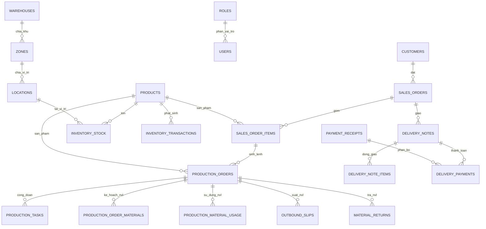

# Bản đồ dữ liệu MES

> Cập nhật theo `backend/migrations/schema_consolidated.sql` ngày 12-11-2026. Đây là bản đồ **từ mã nguồn** (43 bảng khai báo), không thay thế cho kiểm tra trực tiếp schema/dữ liệu trên Supabase production.

## 1. Nhóm bảng

| Nhóm | Bảng |
|---|---|
| Danh mục & hệ thống | `products`, `customers`, `employees`, `machines`, `shifts`, `warehouses`, `zones`, `locations`, `app_settings` |
| Xác thực & quyền | `users`, `roles`, `revoked_tokens` |
| Kỹ thuật | `boms`, `bom_lines`, `tech_processes`, `process_steps`, `product_attachments` |
| Bán hàng & công nợ | `sales_orders`, `sales_order_items`, `delivery_notes`, `delivery_note_items`, `delivery_returns`, `delivery_return_items`, `payment_receipts`, `delivery_payments`, `customer_opening_balances`, `opening_balance_payments` |
| Sản xuất | `production_orders`, `production_tasks`, `production_order_materials`, `production_material_usage`, `production_roll_usage`, `work_schedules` |
| Kho & vật tư | `inventory_stock`, `inventory_transactions`, `outbound_slips`, `outbound_slip_lines`, `material_returns`, `material_return_items` |
| Phế & tái chế | `daily_scrap_records`, `daily_scrap_items`, `recycling_tickets`, `recycling_rolls` |

## 2. Luồng quan hệ chính



## 3. Nguyên tắc dữ liệu quan trọng

### Kho

- `inventory_stock` là ảnh tồn hiện tại theo sản phẩm, vị trí, thông số/lô.
- `inventory_transactions` là sổ biến động, dùng để giải thích vì sao tồn thay đổi.
- Luồng ghi kho nên dùng helper `core/lib/stock.js` để ghi cả hai bảng trong cùng transaction.
- Xuất NVL cho lệnh dùng `outbound_slips` / `outbound_slip_lines`; trả NVL dùng `material_returns` / `material_return_items`.
- Khi rà soát chênh lệch, đối chiếu ảnh tồn với tổng giao dịch theo từng `product_id`, `location_id`, `spec_key`, `lot_code` trước khi sửa số liệu.

### Sản xuất và phế

- `production_orders` là lệnh SX; `production_tasks` là công đoạn/phân công của lệnh.
- Nhu cầu NVL và lượng sử dụng thực tế tách ở `production_order_materials` và `production_material_usage`.
- Phế được ghi theo ngày/nhân viên ở `daily_scrap_records` và `daily_scrap_items`. Báo cáo sản lượng dùng helper tổng hợp phế theo ngày; không suy ra phế bằng cách cộng tùy tiện mọi task.
- Công đoạn cuối được xác định qua helper `core/lib/finalStage.js`. Khi chỉnh logic sản lượng phải giữ nhất quán với báo cáo, dashboard và trạng thái lệnh.

### Bán hàng, giao hàng và công nợ

- Đơn hàng có header `sales_orders` và dòng `sales_order_items`.
- Giao hàng dùng `delivery_notes` / `delivery_note_items`; trả hàng dùng các bảng `delivery_returns*`.
- Một phiếu thu `payment_receipts` có thể được phân bổ sang nhiều phiếu giao qua `delivery_payments`; số dư đầu kỳ nằm ở `customer_opening_balances` và lịch sử phân bổ tại `opening_balance_payments`.
- Không cập nhật số công nợ bằng một cột tổng độc lập nếu chưa kiểm tra quan hệ phiếu giao, trả hàng và phiếu thu.

## 4. Migration và nguồn sự thật

`backend/scripts/migrate.js` chỉ đọc `backend/migrations/schema_consolidated.sql`:

- Phần trước `-- POST-MIGRATION` là base schema.
- Phần sau là các cập nhật bổ sung theo hướng có thể chạy lặp lại.
- Các SQL trong `backend/migrations/manual/` không được runner tự chạy.

Đừng xem tên thư mục hoặc file SQL cũ là bằng chứng database hiện tại đã có cùng cấu trúc. Trước khi sửa/khôi phục dữ liệu production, dùng SQL read-only để xác nhận bảng/cột/ràng buộc thực tế:

```sql
SELECT table_name
FROM information_schema.tables
WHERE table_schema = 'public'
ORDER BY table_name;

SELECT column_name, data_type, is_nullable
FROM information_schema.columns
WHERE table_schema = 'public' AND table_name = 'production_orders'
ORDER BY ordinal_position;
```

## 5. Checklist thay đổi schema

1. Mô tả tác động đến dữ liệu cũ và dữ liệu mới.
2. Sao lưu database trước khi áp dụng production.
3. Ưu tiên `IF EXISTS`/`IF NOT EXISTS`, transaction và backfill có thể kiểm chứng.
4. Kiểm thử trên bản copy; xác nhận lại `DATABASE_URL` trước khi chạy.
5. Cập nhật query/controller, tài liệu này và [DEPLOY.md](DEPLOY.md) nếu cách vận hành thay đổi.
